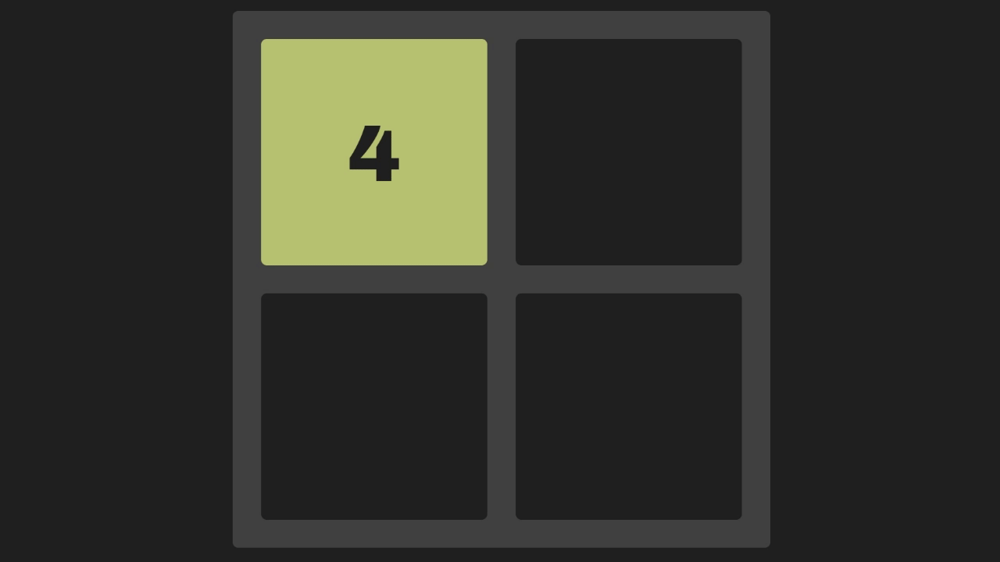

# 2048 Dynamic

Браузерная игра 2048 с динамически растущим полем.
Чистый JavaScript, без фреймворков и зависимостей.

## Задача

Браузерная 2048 с растущим полем. Хотелось сделать что-то
интерактивное после консольных задач и разобраться с DOM,
событиями и анимациями на чистом JS.

## Реализация

- **Сетка** — класс `Grid`: одномерный массив ячеек + четыре
  проекции (строки/столбцы и их реверсы).
- **Плитки** — класс `Tile`. Координаты через CSS-переменные
  `--x`/`--y`, цвет через `hsl` от `log2(value)`.
- **Расширение поля** — при достижении порога (16, 64, 256, …)
  создаётся новый `Grid`, плитки переносятся методами
  `moveUpTiles`/`moveDownTiles`/… в зависимости от направления
  последнего хода. Старая сетка удаляется.
- **Ввод** — клавиатура (стрелки) и тачскрин (свайпы).

## Результат

- Поле увеличивается до 2×2 → 3×3 → 4×4 → … при достижении 16, 64, 256, 1024
- Плавные анимации сдвига и слияния
- Работает на десктопе и мобильных