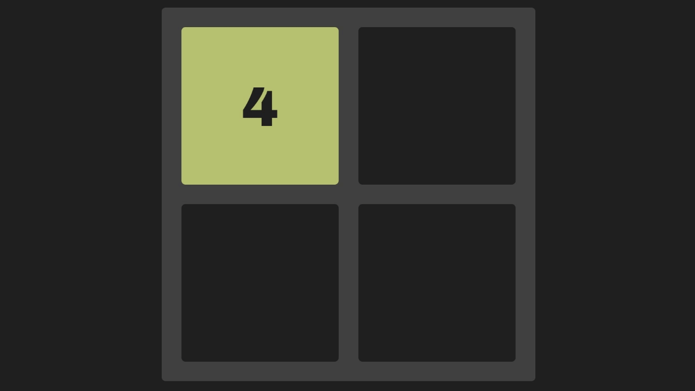

# 2048 Dynamic

Браузерная версия игры 2048 с динамически растущим полем:
начинается на 2×2, при достижении пороговых значений (16, 64, 256, …)
поле расширяется до 3×3, 4×4, 5×5 и так далее. Плитки при этом
переезжают в новое поле, сохраняя позиции относительно направления
последнего хода. Написано на чистом JavaScript (ES-модули), без фреймворков
и сборщиков. Открывается в браузере.

## Как играть

- **Клавиатура:** стрелки ← ↑ → ↓
- **Тачскрин:** свайпы в четырёх направлениях
- Цель — собрать плитку **2048**
- При достижении 16, 64, 256, 1024 поле расширяется на 1 в каждую сторону

## Как устроено

- **`index.html`** — точка входа, контейнер `#game-board`
- **`script.js`** — игровой цикл: ввод, проверка победы/поражения,
  расширение поля
- **`classes/grid.js`** — сетка, четыре проекции
  (столбцы/строки и их реверсы), поиск пустой ячейки, перенос плиток
  при расширении
- **`classes/cell.js`** — ячейка поля
- **`classes/tile.js`** — DOM-элемент плитки

## Контекст

Курсовая работа по дисциплине «Алгоритмы и структуры данных».
Тема выбрана самостоятельно — хотелось сделать что-то интерактивное
после консольных задач. Пояснительная записка
с анализом сложности алгоритмов — в `docs/report.pdf`.